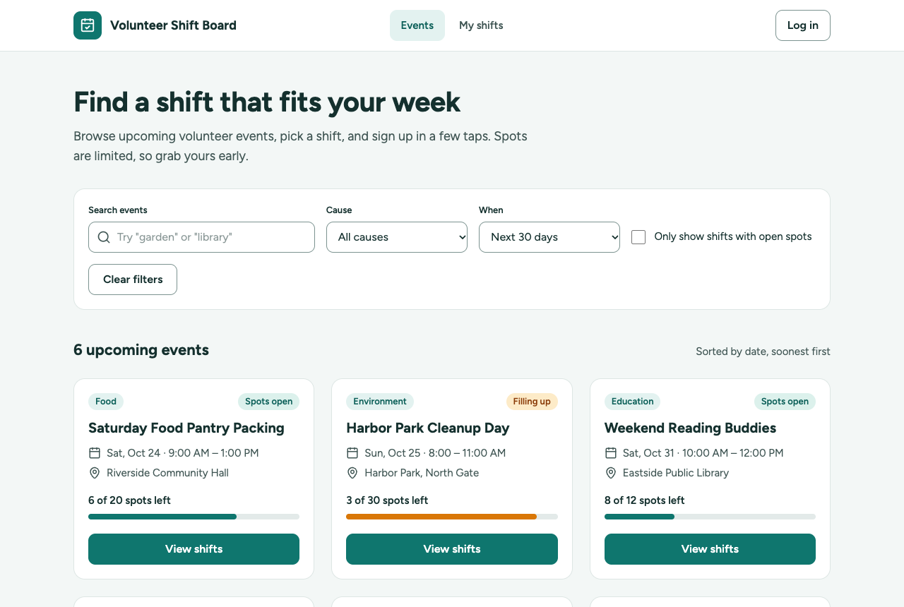
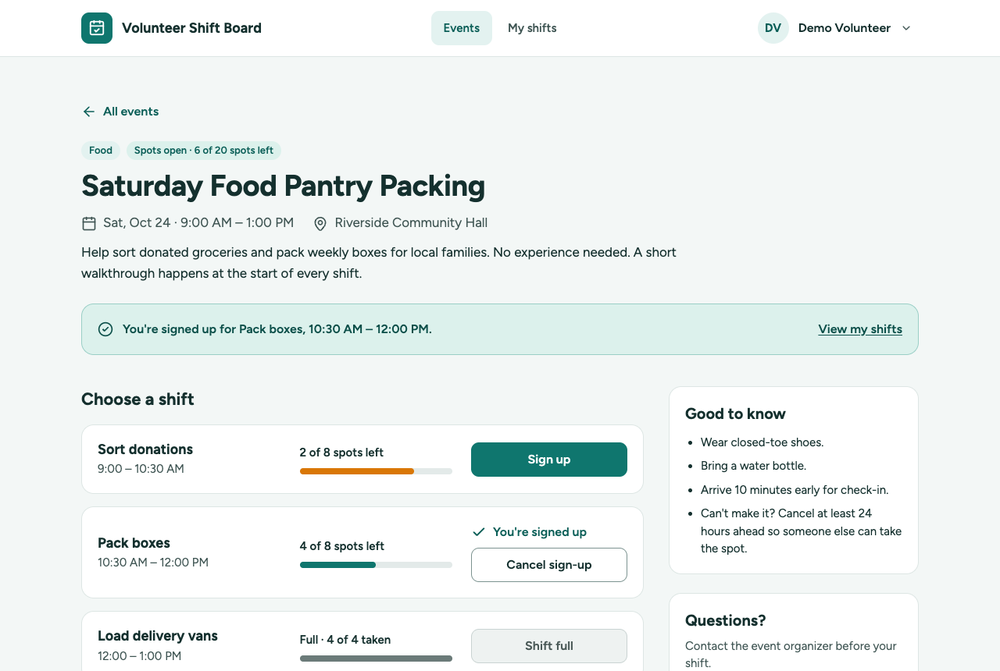
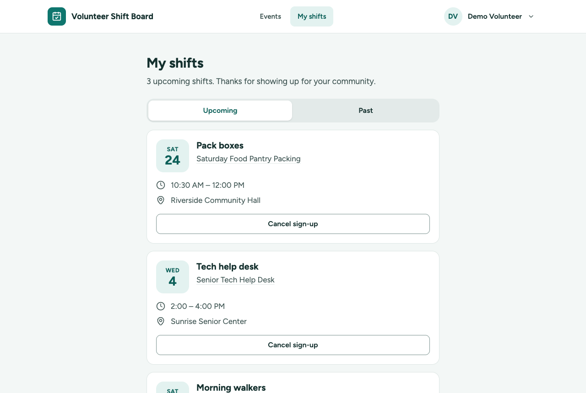
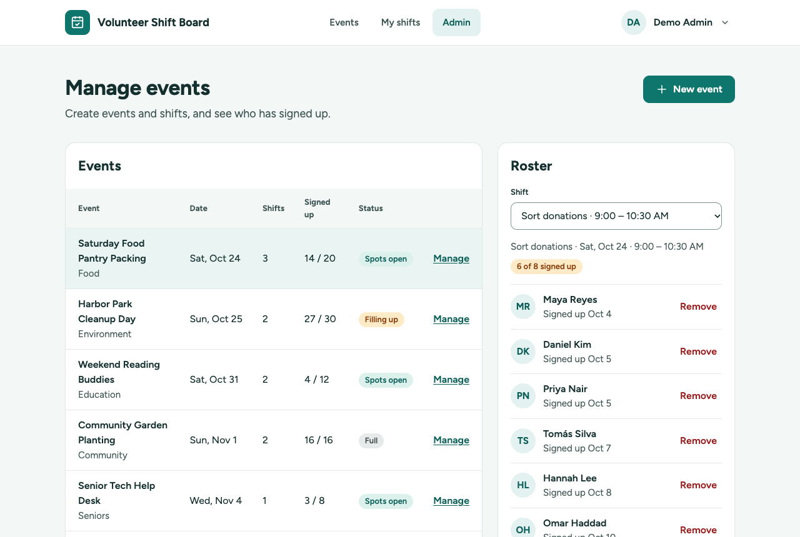
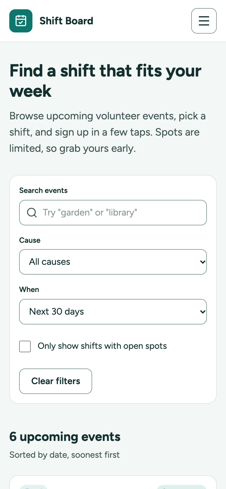
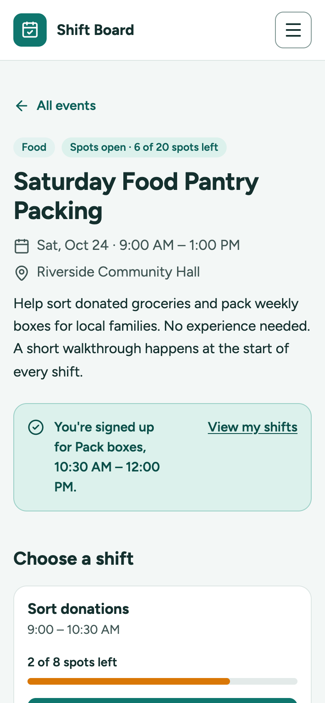
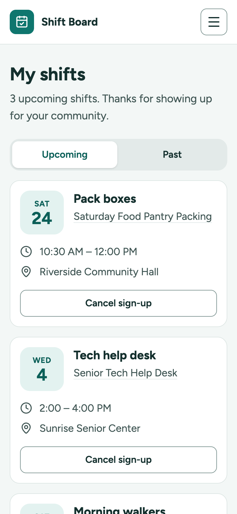
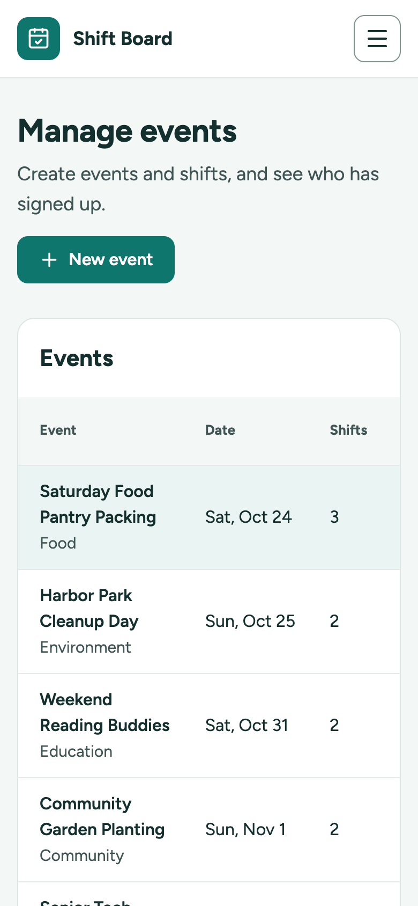
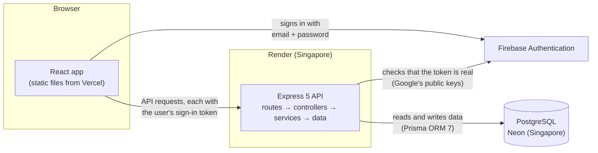

# Volunteer Shift Board

A small web app where volunteers find events and sign up for shifts, and admins create events and see who is coming. It was built in two days as a portfolio project.

Before the code for each feature was written, a short plan was written for it: what it should do, how it would be built, and a task list. A tool called [OpenSpec](https://github.com/Fission-AI/OpenSpec) was used for this, and all the plans are in [`openspec/changes/`](openspec/changes/).

- **Live app:** https://lauritzkeans-volunteer-shift-board.vercel.app
- **API health check:** https://lauritzkeans-volunteer-shift-board-api.onrender.com/api/health (shows `{"status":"ok"}` when the server and the database are up)

> The server runs on Render's free plan. When nobody uses it for 15 minutes, it goes to sleep, and the next visit has to wake it up. This takes up to a minute. During that time the app shows a "Waking up the server…" message.

## Demo logins

Both accounts are shared on purpose. The easiest way in is the **Continue as demo volunteer** or **Continue as demo admin** button on the login page.

| Account | Email | Password | What it can do |
|---|---|---|---|
| Demo volunteer | `demo.volunteer@example.com` | `123@Seaboo` | Browse events, sign up for shifts and manage them under My shifts. Starts with three upcoming shifts. |
| Demo admin | `demo.admin@example.com` | `123@Seaboo` | Everything a volunteer can do, plus the Admin page: create events and shifts, see who signed up and remove volunteers. |

You can also create your own account on the sign-up page. New accounts are always volunteers. Only admins see the Admin link, and even if someone calls the admin API in another way, the server checks the role and refuses.

## Screenshots

| Events list | Event detail (signed in) |
|---|---|
|  |  |
| **My shifts** | **Admin** |
|  |  |

On a phone:

<p>
  
  
  
  
</p>

To take them again after a UI change, run `npm --prefix client run screenshots` while `npm run dev` is running with freshly loaded demo data.

## How it works



The app has three parts:

- **The client** is a React app. It is only static files (HTML, JavaScript and CSS) that Vercel serves, and it runs in your browser.
- **The API** is an Express server on Render. It owns all the business rules, for example "a shift can't have more people than its capacity". The client checks the same rules to give quick feedback, but the server always makes the final decision.
- **The database** is PostgreSQL on Neon.

Sign-in uses Firebase Authentication, but Firebase only answers one question: "who is this person?". After sign-in, the browser gets an ID token (a signed piece of text that proves who the user is) and sends it with every API request. The roles (volunteer or admin) are stored in the app's own database, not in Firebase.

All events happen in one time zone, Asia/Manila. The server decides what "today" is, and the client shows every date and time in Manila time, even if your computer uses another time zone.

| Part | What was used |
|---|---|
| Client | React 19 and TypeScript, built with Vite; Tailwind CSS v4 for styling; TanStack Query (keeps the API data in a cache); React Router (pages); React Hook Form and Zod (forms and their rules); shadcn/ui (ready-made accessible dialog, tabs and pop-up messages) |
| API | Express 5 and TypeScript; Zod checks every request; the code is split into layers: routes → controllers → services → data |
| Sign-in | Firebase Authentication with email and password; the API checks the tokens with the `jose` library |
| Database | PostgreSQL on Neon; Prisma ORM 7 talks to the database |
| Hosting | Vercel (client), Render (API), Neon (database), all on free plans |
| Tests | Vitest (test runner) and Supertest (sends real HTTP requests to the API); axe-core and Lighthouse for accessibility |

```
client/     React app (Vite); scripts/ has the accessibility check and the screenshot script
server/     Express API, Prisma schema, migrations, demo data (seed) and tests
openspec/   Plans for each change: specs, designs and task lists
docs/       Screenshots
```

## Frontend highlights

- **API data lives in one cache.** TanStack Query keeps the data from the API in a cache. After every action, it is told which data is now out of date, and that data is fetched again. For example, after a sign-up the event page, the events list and My shifts all refresh. After an admin removes a volunteer, the admin table and the roster refresh too.
- **The server decides.** Sometimes the page is already old, for example because someone took the last spot a second ago. Then the server refuses the sign-up, the app shows the server's reason in a small pop-up message (a toast), and the page loads the real data again.
- **Filters are saved in the URL.** When you search or filter events, the URL changes too. So you can reload the page, share the link or press Back, and you still see the same results.
- **Forms check your input while you fill them in.** When you leave a field, React Hook Form and Zod check it right away, with the same rules and the same messages as the server. The error appears under the field with an icon and a red border. Screen readers read it out too, because the field is marked with `aria-invalid` and linked to the message with `aria-describedby`. If the server finds a problem, its message appears in the same place.
- **A sleeping server is explained, not hidden.** Before it loads any data, the app calls `/api/health`. If there is no answer after 3 seconds, it shows "Waking up the server…". After 90 seconds without an answer, it shows a "Try again" button.
- **Every state has a design.** Loading (grey placeholder cards, called skeletons), no results (with a way out, like "Clear filters"), errors (with "Try again"), and a toast after every action. A browser script was used to force each of these states on every screen: slow answers, failing answers, empty data, and every kind of refused sign-up (`409`).
- **The first download is small.** The code is split, so the sign-in pages, My shifts and Admin are separate files. The browser downloads them only when you open those pages. A first-time visitor downloads 185 kB (gzip-compressed) instead of 228 kB.

## Backend highlights

- **Clear layers.** Each request goes through four layers, and each layer has one job. Routes decide which code handles which URL. Controllers read the request and send the response. Services hold the business rules. Data functions talk to the database through Prisma. Before a controller runs, Zod checks the query string and the body, and every error comes back in the same JSON format.
- **Checking sign-in without a secret key on the server.** Firebase signs every ID token. The API checks this signature with the `jose` library and Google's public keys, so the server doesn't need a Firebase service account (a private key with admin rights). On a user's first request, the API links the Firebase account to a user in the app's database by email.
- **One guard for all admin endpoints.** Every endpoint under `/api/admin` goes through the same two checks: "is the user signed in?" (`requireAuth`) and "is the user an admin?" (`requireAdmin`). A new admin endpoint is protected automatically, so none can be forgotten by mistake.
- **One clock.** The code always asks one small module for the current time. In the tests, this clock is set to a fixed date, so rules that depend on time (like the 24-hour cancellation rule) give the same result every time.
- **Tests run against a real database.** There are 149 server tests. They send real HTTP requests to the API with Supertest and use a separate Neon database branch called `test`, so they never touch the real data. They include the concurrency tests described below. There are also 54 client unit tests for date formatting and form rules.

### How sign-ups stay correct

**The problem.** To sign someone up, the API first checks the rules (is there a free spot? is this person already on the shift? does it overlap another of their shifts?) and then saves the sign-up. If two people click "Sign up" at the same moment, both requests can read "7 of 8 taken" before either of them saves. Then both save, and the shift has 9 people for 8 spots. This is called a race condition.

**The solution.** Everything happens inside one database transaction, which is a group of steps that is saved completely or not at all ([`server/src/services/signups.ts`](server/src/services/signups.ts)):

1. **Lock the volunteer's row, then the shift's row**, with `SELECT … FOR UPDATE` ([`server/src/data/signups.ts`](server/src/data/signups.ts)). A row lock means that any other request that wants the same row has to wait until this transaction is finished. Postgres uses its default isolation level, READ COMMITTED. In simple words, every new query sees everything that other transactions have already saved. So when the waiting request continues, it sees the sign-up that was just saved, and it counts correctly.
   - The **shift** lock protects the capacity. "At most 8 sign-ups" is a rule about many rows together, and a normal database constraint can't check that.
   - The **volunteer** lock protects against overlaps. Two overlapping shifts are two different rows, so only a lock on the person can stop two requests from passing the overlap check at the same time.
   - Every request locks in the same order, first the volunteer and then the shift. Because of this, two transactions can never wait for each other forever (this is called a deadlock).
2. **Check the rules** inside the same transaction: the shift exists and hasn't started, the volunteer isn't on it yet, there is a free spot, and it doesn't overlap another of their shifts.
3. **Save the sign-up and commit** (finish the transaction). This releases both locks.

The database itself also has a safety net: a unique constraint, `UNIQUE (user_id, shift_id)`, on the `signups` table ([`server/prisma/schema.prisma`](server/prisma/schema.prisma)). It means the same person can never be on the same shift twice. If the duplicate check in the code ever failed, the database would refuse the insert with Prisma error P2002, and the API would still answer `409 ALREADY_SIGNED_UP` ([`server/tests/signups.test.ts`](server/tests/signups.test.ts), the test "falls back on the unique constraint").

Cancelling, or an admin removing a volunteer, doesn't need a lock. Deleting a sign-up can only free a spot, so it can't break any rule.

**It was tested against a real Postgres database.** [`server/tests/signups-concurrency.test.ts`](server/tests/signups-concurrency.test.ts) sends many requests at the same moment to the Neon `test` branch. The requests go through the same pooled connection as the app (a connection pool shares a few database connections between many requests):

| Race | Result |
|---|---|
| 10 volunteers, a shift with capacity 3 | exactly 3 succeed, 7 get `SHIFT_FULL` |
| 2 volunteers, the last spot | exactly 1 succeeds |
| 1 volunteer double-clicks | exactly 1 sign-up |
| 1 volunteer, two overlapping shifts at once | exactly 1 succeeds |

To make sure these tests really catch the problem, they were run once with the two `FOR UPDATE` locks removed. Three of the four tests failed, and all 10 volunteers got into the shift with capacity 3. The double-click test still passed, because the unique constraint caught the duplicate by itself.

**Other options that were considered.** SERIALIZABLE isolation (the strictest level, where Postgres makes transactions behave as if they ran one after another) would also be correct. But then Postgres cancels one of the competing transactions, and the API needs extra code to try again. "Wait for your turn" is easier to understand. For a much bigger app, the overlap rule could be moved into the database with an exclusion constraint (`EXCLUDE USING gist (user_id WITH =, tstzrange(starts_at, ends_at) WITH &&)`, which needs the `btree_gist` extension). It tells the database "one user can't have two time ranges that overlap". But it needs a copy of the shift times on every sign-up, which is too much extra work for a volunteer board.

## Accessibility (checked 2026-10-11)

It was measured on the app running locally, signed in with each role where a screen needs it:

- **axe-core 4.13** (an automatic accessibility checker): no problems found on the events list, the event page (signed out and as a volunteer), My shifts and Admin. This includes the Add a shift form showing its errors and the New event dialog, at desktop width (1280px) and phone width (390px). You can run it again with `npm --prefix client run a11y` while `npm run dev` is running. It fails when it finds a serious or critical problem.
- **Lighthouse 13.5** (Google's page audit tool), accessibility score: 100 on all four screens, with both the mobile and the desktop settings.

What was built in from the start: real buttons, links and labels (not clickable `div`s); a visible focus outline on every control for keyboard users; touch targets at least 44px tall; status shown in words, never only with color; dialogs that keep the keyboard focus inside, close with Escape and give the focus back to the button that opened them; and loading and result messages that screen readers announce.

## Decisions and why they were made

For each feature there is a design document in [`openspec/changes/`](openspec/changes/), where the options that were considered are written down, together with the reason one was chosen. The short version:

- **Two simple projects instead of a monorepo.** `client/` and `server/` are separate and deploy on their own, to Vercel and to Render. A monorepo tool like Turborepo, or npm workspaces, helps when projects share a lot of code. Here they share only two small form schemas (the validation rules), so the client keeps its own copy. ([bootstrap design](openspec/changes/archive/2026-10-10-bootstrap-and-deploy/design.md))
- **Row locks for sign-ups, instead of SERIALIZABLE or a counter column.** "Wait for your turn" is easy to explain, and it also prevents overlapping shifts, which a counter can't do. ([shift sign-ups design](openspec/changes/shift-signups/design.md))
- **`jose` instead of `firebase-admin`, and roles in the app's database instead of Firebase custom claims.** To check a token, the server only needs Google's public keys, not a secret key. And with the roles in one place, there is only one source of truth. ([auth design](openspec/changes/auth-and-roles/design.md))
- **Availability calculated on the server, in one function.** The events list, the event page and the admin table all show the same "Spots open / Filling up / Full", because the rule exists only once. ([browse design](openspec/changes/browse-events/design.md))
- **One time zone for the whole app.** The events happen in person, so a 9 AM shift should show 9 AM for everyone, not 6 AM for a reviewer in another country. ([bootstrap design](openspec/changes/archive/2026-10-10-bootstrap-and-deploy/design.md))
- **Separate endpoints for admins.** The admin list also shows events that have no shifts yet. So it has its own endpoint, instead of a public endpoint that behaves differently depending on who asks. ([admin design](openspec/changes/admin-dashboard/design.md))
- **Free hosting, and the app is honest about it.** On a free plan the server sleeps. So instead of looking broken, the app tells visitors what is happening.

## API

The API is at `https://lauritzkeans-volunteer-shift-board-api.onrender.com`. All endpoints start with `/api`, and they send and receive JSON. The table is a quick overview; the details for each endpoint follow below.

| Method and path | Who | Success | Errors |
|---|---|---|---|
| `GET /api/health` | anyone | `200` | `503 DATABASE_UNAVAILABLE` |
| `GET /api/events` | anyone | `200` | `400 VALIDATION_ERROR` |
| `GET /api/events/:id` | anyone | `200` | `404 NOT_FOUND` |
| `GET /api/me` | signed in | `200` | `401` |
| `GET /api/me/signups` | signed in | `200` | `400`, `401` |
| `POST /api/shifts/:id/signup` | signed in | `201` | `401`, `404`, `409 SHIFT_STARTED`, `ALREADY_SIGNED_UP`, `SHIFT_FULL`, `SHIFT_OVERLAP` |
| `DELETE /api/signups/:id` | signed in, own sign-up | `204` | `401`, `404`, `409 CANCELLATION_CLOSED` |
| `GET /api/admin/events` | admin | `200` | `401`, `403` |
| `POST /api/admin/events` | admin | `201` | `400`, `401`, `403` |
| `POST /api/admin/events/:id/shifts` | admin | `201` | `400`, `401`, `403`, `404` |
| `GET /api/admin/shifts/:id/roster` | admin | `200` | `401`, `403`, `404` |
| `DELETE /api/admin/signups/:id` | admin | `204` | `401`, `403`, `404` |

What the status codes mean: `200` OK, `201` created, `204` done (no content to send back), `400` some input is invalid, `401` not signed in, `403` signed in but not allowed, `404` not found, `409` the request conflicts with the current data (for example, the shift is already full), `503` the database is not answering.

Every error has the same format. The `details` list appears only when some input is invalid:

```json
{
  "error": {
    "code": "VALIDATION_ERROR",
    "message": "Some of the information sent is invalid.",
    "details": [{ "path": "when", "message": "Invalid option: expected one of \"next7\"|\"next30\"|\"all\"" }]
  }
}
```

- **Sign-in:** endpoints that need a user expect the Firebase ID token in a header: `Authorization: Bearer <token>`. Without a valid token they answer `401 UNAUTHENTICATED`. Everything under `/api/admin` answers `403 FORBIDDEN` to users who aren't admins. The role always comes from the app's database, never from the token.
- **Any endpoint** can also answer `400 BAD_REQUEST` when the body isn't valid JSON, and `500 INTERNAL_ERROR` when something unexpected goes wrong.
- **Status:** every event and shift has a `status` that the server calculates: `full` when no spots are left, `filling` when 75% or more are taken, otherwise `open`.
- **Times** are moments in UTC (for example `2026-10-17T01:00:00.000Z`). **Dates** are `YYYY-MM-DD` in the app time zone (Asia/Manila). An unknown or badly formed id gives `404 NOT_FOUND`.

### `GET /api/health`

Checks that the server is running and that the database answers a simple query. It answers `200` with `{"status":"ok"}`, or `503 DATABASE_UNAVAILABLE` when the database doesn't answer within 10 seconds.

```
curl "https://lauritzkeans-volunteer-shift-board-api.onrender.com/api/health"
```

### `GET /api/events`

Lists the upcoming events (dated today or later) that have at least one shift. They are sorted by date, and then by their earliest shift. No sign-in needed.

| Parameter | Values | Default |
|---|---|---|
| `q` | Text to find in the title, location or description, ignoring upper and lower case (up to 100 characters) | none |
| `cause` | `food`, `environment`, `education`, `community`, `seniors` or `animals` | every cause |
| `when` | `next7` or `next30` (from today to 7 or 30 days ahead), or `all` | `all` |
| `openOnly` | `true` keeps only events with a shift that still has a free spot | `false` |

```
curl "https://lauritzkeans-volunteer-shift-board-api.onrender.com/api/events?q=pantry"
```

```json
{
  "events": [
    {
      "id": "05b30ea8-0f23-4240-8e37-f19b545404af",
      "title": "Saturday Food Pantry Packing",
      "cause": "food",
      "date": "2026-10-17",
      "startsAt": "2026-10-17T01:00:00.000Z",
      "endsAt": "2026-10-17T05:00:00.000Z",
      "location": "Riverside Community Hall",
      "capacity": 20,
      "signedUpCount": 14,
      "spotsLeft": 6,
      "status": "open"
    }
  ],
  "total": 1
}
```

It answers `200`, or `400 VALIDATION_ERROR` for an unknown `cause` or `when`, or for a `q` longer than 100 characters.

### `GET /api/events/:id`

One event with the same fields, plus its `description` and its `shifts` (sorted by start time). No sign-in needed. The event ids change every time the demo data is loaded again, so copy an id from the list above:

```
curl "https://lauritzkeans-volunteer-shift-board-api.onrender.com/api/events/<id>"
```

```json
{
  "id": "05b30ea8-0f23-4240-8e37-f19b545404af",
  "title": "Saturday Food Pantry Packing",
  "…": "the list fields above",
  "description": "Help sort donated groceries and pack weekly boxes for local families. …",
  "shifts": [
    {
      "id": "54bd4e7f-018e-4983-8eb6-daf89fdfa447",
      "name": "Sort donations",
      "startsAt": "2026-10-17T01:00:00.000Z",
      "endsAt": "2026-10-17T02:30:00.000Z",
      "capacity": 8,
      "signedUpCount": 6,
      "spotsLeft": 2,
      "status": "filling"
    }
  ]
}
```

It answers `200`, or `404 NOT_FOUND` for an unknown or badly formed id:

```
curl -i "https://lauritzkeans-volunteer-shift-board-api.onrender.com/api/events/not-a-real-id"
```

When the request includes a valid token, every shift also has a `viewer` object that tells what this user can do with it: `{ "state": "signed_up", "signupId": "…", "canCancel": true }` when they are already signed up, or a `state` of `started`, `full`, `overlap` (it overlaps one of their shifts) or `open`.

### `GET /api/me`

Returns the signed-in user as the app's database knows them: `id`, `name`, `email`, `role` (`volunteer` or `admin`) and `initials`. On the first request, the API links the Firebase account to the user with the same email. If there is no such user, it creates a new volunteer.

```
curl -i "https://lauritzkeans-volunteer-shift-board-api.onrender.com/api/me"
```

It answers `200`, or `401 UNAUTHENTICATED` without a valid token (like in this example).

### `GET /api/me/signups`

The signed-in user's sign-ups. With `when=upcoming` (the default) you get the shifts that haven't ended yet, soonest first. With `when=past` you get the shifts that have ended, most recent first.

```json
{
  "signups": [
    {
      "signupId": "…",
      "canCancel": true,
      "shift": { "id": "…", "name": "Pack boxes", "startsAt": "2026-10-24T02:30:00.000Z", "endsAt": "2026-10-24T04:00:00.000Z" },
      "event": { "id": "…", "title": "Saturday Food Pantry Packing", "location": "Riverside Community Hall" }
    }
  ],
  "total": 1
}
```

`canCancel` becomes `false` when the shift starts in 24 hours or less. It answers `200`, `400 VALIDATION_ERROR` for any other `when`, or `401`.

### `POST /api/shifts/:id/signup`

Signs the current user up for the shift. The request has no body. It answers `201` with the new sign-up's `id` and the shift's new numbers: `capacity`, `signedUpCount`, `spotsLeft` and `status`. The server checks the rules in this order, and each rule has its own `409` code:

| Code | Message |
|---|---|
| `SHIFT_STARTED` | This shift has already started. |
| `ALREADY_SIGNED_UP` | You're already signed up for this shift. |
| `SHIFT_FULL` | This shift just filled up. |
| `SHIFT_OVERLAP` | This shift overlaps another shift you've signed up for. |

An unknown shift gives `404 NOT_FOUND`, and a request without a token gives `401`:

```
curl -i -X POST "https://lauritzkeans-volunteer-shift-board-api.onrender.com/api/shifts/not-a-real-id/signup"
```

### `DELETE /api/signups/:id`

Cancels one of the current user's own sign-ups and answers `204`. In the last 24 hours before the shift, it answers `409 CANCELLATION_CLOSED` ("Cancellations close 24 hours before the shift. Please contact the organizer."). If the sign-up belongs to someone else, the answer is `404`, the same as for a sign-up that doesn't exist. This way nobody can find out which sign-up ids exist.

### `GET /api/admin/events`

Every event dated today or later, also the ones without shifts, sorted by date. Each one has `id`, `title`, `cause`, `date`, `shiftCount`, `signedUpCount`, `capacity` and `status` (`null` while the event has no shifts).

```
curl -i "https://lauritzkeans-volunteer-shift-board-api.onrender.com/api/admin/events"
```

It answers `200` for an admin, `401` without a token (like in this example), or `403 FORBIDDEN` for a volunteer.

### `POST /api/admin/events`

Creates an event and answers `201` with its `id`. A new event has no shifts, so only the admin list shows it until someone adds a shift.

| Field | Rule |
|---|---|
| `title` | 3 to 100 characters |
| `cause` | `food`, `environment`, `education`, `community`, `seniors` or `animals` |
| `date` | `YYYY-MM-DD`, today or later in the app time zone |
| `location` | 3 to 100 characters |
| `description` | 1 to 1,000 characters |

When a field is invalid, the answer is `400 VALIDATION_ERROR` with one detail per field, for example `{ "path": "date", "message": "Pick today or a later date." }`.

### `POST /api/admin/events/:id/shifts`

Adds a shift to an upcoming event and answers `201` with its `id`, `name`, `startsAt`, `endsAt` and `capacity`.

| Field | Rule |
|---|---|
| `name` | 1 to 80 characters |
| `startTime`, `endTime` | Clock times as `HH:mm` on the event's date, in the app time zone. The end must be after the start |
| `capacity` | whole number from 1 to 200 |

The validation details use these field names. There is one extra: `eventId` ("Shifts can only be added to upcoming events.") when the event's date is before today. An unknown event gives `404`.

### `GET /api/admin/shifts/:id/roster`

One shift with its `name`, `startsAt`, `endsAt`, `capacity`, `signedUpCount`, `spotsLeft` and `status`, plus its `signups`, oldest first. Every sign-up has `signupId`, `name`, `initials` and `signedUpAt`. It answers `200` or `404`.

### `DELETE /api/admin/signups/:id`

Removes any volunteer's sign-up and answers `204`. The 24-hour rule doesn't apply to admins. When the sign-up doesn't exist anymore, the answer is `404 NOT_FOUND` ("That sign-up no longer exists.").

## Run it locally

You need Node 24 (`nvm use` picks the version from `.nvmrc`) and a Neon project with two database branches, `dev` and `test`. A Neon branch is a separate copy of the database, so the tests can never touch your development data.

1. Install the dependencies:
   ```
   nvm use
   npm install
   npm --prefix server install
   npm --prefix client install
   ```
2. Copy `server/.env.example` to `server/.env` (for the Neon `dev` branch) and to `server/.env.test` (for the Neon `test` branch). Then fill in the connection strings and your Firebase project id.
   Copy `client/.env.example` to `client/.env` and fill in the Firebase web app settings (Firebase console → Project settings → Your apps) and the two demo passwords.
3. Prepare the databases:
   ```
   cd server
   npm run db:migrate        # apply migrations to dev and generate the Prisma client
   npm run db:migrate:test   # apply migrations to test
   npm run db:seed           # load the demo data into dev
   cd ..
   ```
4. Start both apps with `npm run dev`. The client runs on http://localhost:5173 and the API on http://localhost:4000.
5. Run all the tests with `npm test`. The server tests use the Neon `test` branch, never `dev`.

### Environment variables

These settings live outside the code, in `.env` files that are not committed to git.

**Server** (`server/.env`)

| Variable | Purpose |
|---|---|
| `DATABASE_URL` | Neon connection through its connection pooler (the host contains `-pooler`, and it uses `sslmode=verify-full`). The app uses this one |
| `DIRECT_URL` | Direct Neon connection, without the pooler. Prisma uses it to run migrations (changes to the database structure) |
| `CLIENT_ORIGIN` | The client's URL. Only this address may call the API from a browser (CORS) |
| `APP_TIMEZONE` | The time zone for "today", for the times admins type in, and for display. Default `Asia/Manila` |
| `PORT` | The API's port. Default `4000`; Render sets its own |
| `FIREBASE_PROJECT_ID` | The Firebase project whose ID tokens the API accepts |

**Client** (`client/.env`)

| Variable | Purpose |
|---|---|
| `VITE_API_URL` | The API's address. Default http://localhost:4000 |
| `VITE_APP_TIMEZONE` | The time zone for display; it must match the server's `APP_TIMEZONE`. Default `Asia/Manila` |
| `VITE_FIREBASE_API_KEY`, `VITE_FIREBASE_AUTH_DOMAIN`, `VITE_FIREBASE_PROJECT_ID` | Firebase web app settings |
| `VITE_DEMO_VOLUNTEER_PASSWORD`, `VITE_DEMO_ADMIN_PASSWORD` | Passwords for the one-click demo logins |

Every `VITE_` variable ends up inside the JavaScript that the browser downloads, so none of them may hold a secret.

## Deployment

- **Database (Neon):** the migrations and the demo data (the seed) are applied to the production branch from a laptop, with a `server/.env.production` file that is not in git:
  ```
  cd server
  ENV_FILE=.env.production npx prisma migrate deploy
  ENV_FILE=.env.production npm run db:seed
  ```
  Render also runs `prisma migrate deploy` on every build.
- **API (Render):** [`render.yaml`](render.yaml) describes the service as a Render Blueprint (a settings file that Render reads): free plan, Singapore region, build and start commands, and the health check. In Render, choose **New → Blueprint** and pick this repository. It asks once for `DATABASE_URL` and `DIRECT_URL`.
- **Sign-in (Firebase):** a Firebase project with Email/Password sign-in turned on, the Vercel domain added under Authentication → Settings → Authorized domains, and the two demo users created by hand under Authentication → Users. The API doesn't need a service account, because it checks the tokens with Google's public certificates.
- **Client (Vercel):** import the repository with Root Directory `client` (Vite preset). Then set `VITE_API_URL` to the Render URL, `VITE_APP_TIMEZONE` to `Asia/Manila`, and the five Firebase and demo-login variables from `client/.env.example`. [`client/vercel.json`](client/vercel.json) sends `index.html` for every path, so a direct link like `/my-shifts` still works after a reload.

Pushing to `main` deploys both again. Vercel's preview deployments can't call the API, because CORS only allows the production client URL.

## Free-tier notes (checked 2026-10-10)

- **Render free web service:** sleeps after 15 minutes without traffic and takes about a minute to wake up; 750 instance hours per month.
- **Neon free:** 1 GB per project and 100 compute hours per month; the database pauses after 5 minutes without use.
- **Vercel Hobby:** for personal, non-commercial projects.

## Known limitations

- Not included, on purpose: editing or deleting events and shifts, email notifications, waitlists, pagination, and more than one organization. A shift always starts and ends on its event's date, and all events use the same time zone.
- The demo accounts are shared. If another reviewer changes something, you will see it until the demo data is loaded again.
- `npm audit` in `server/` reports high-severity warnings in `deepmerge-ts` and `mysql2`. Both come with the Prisma command-line tool, and neither handles untrusted input here: the first only merges Prisma's own config file, and the second is a MySQL driver that this project never loads. The only fix on offer is going back to Prisma 6.
- After you sign out, a copied ID token keeps working until it expires (at most one hour). To check for cancelled (revoked) tokens, the server would need Firebase's Admin SDK and a service account, which was avoided on purpose.
- `npm audit` in `client/` reports high-severity warnings in `@grpc/grpc-js`, which comes with Firebase's Firestore package. The app imports only Firebase's `app` and `auth` modules, and the built JavaScript contains no gRPC code.
