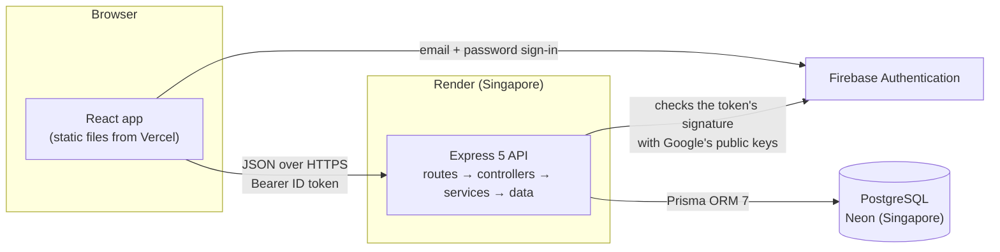

# Volunteer Shift Board

Volunteers browse upcoming events and sign up for shifts. Admins create events and shifts and see who's coming. A full-stack portfolio project, built in two days with spec-driven development.

- **Live demo:** https://lauritzkeans-volunteer-shift-board.vercel.app
- **API health:** https://lauritzkeans-volunteer-shift-board-api.onrender.com/api/health

> The API runs on Render's free tier, which sleeps after 15 minutes without traffic. The first visit after a quiet spell shows a "Waking up the server…" notice for up to a minute.

## Demo logins

Both accounts are shared on purpose. The quickest way in is the **Continue as demo volunteer** or **Continue as demo admin** button on the login page.

| Account | Email | Password | What it can do |
|---|---|---|---|
| Demo volunteer | `demo.volunteer@example.com` | `123@Seaboo` | Browse events, sign up for shifts and manage them under My shifts. Starts with three upcoming shifts. |
| Demo admin | `demo.admin@example.com` | `123@Seaboo` | Everything a volunteer can, plus the Admin page: create events and shifts, see who signed up and remove volunteers. |

You can also create your own account on the sign-up page; new accounts are always volunteers. Only admins see the Admin link, and the API refuses admin requests from everyone else, whatever the page shows.

## Screenshots

| Events list | Event detail (signed in) |
|---|---|
|  |  |
| **My shifts** | **Admin** |
|  |  |

On a phone:

<p>
  
  
  
  
</p>

Retake them with `npm --prefix client run screenshots` while `npm run dev` is running on freshly seeded data.

## Architecture



- Firebase only proves who someone is. Roles, sign-ups and every business rule live in the app's own database and are enforced by the API; the client mirrors the rules for usability but is never the only guard.
- Events take place in one time zone, Asia/Manila. The server decides "today" and converts admin-entered times; the client formats every date and time in that zone, whatever the viewer's device says.

| Layer | Choice |
|---|---|
| Client | React 19, Vite, TypeScript, Tailwind CSS v4, TanStack Query, React Router, React Hook Form, Zod, shadcn/ui (Dialog, Tabs, toasts) |
| API | Express 5, TypeScript, Zod, in layers: routes → controllers → services → data |
| Sign-in | Firebase Authentication (email and password); the API verifies ID tokens with `jose` |
| Database | PostgreSQL on Neon, Prisma ORM 7 |
| Hosting | Vercel (client), Render (API), Neon (database), all on free tiers |
| Tests | Vitest and Supertest; axe-core and Lighthouse for accessibility |

```
client/     React app (Vite); scripts/ holds the accessibility check and screenshot capture
server/     Express API, Prisma schema, migrations, seed and tests
openspec/   Specs, designs and task lists for each change
docs/       Screenshots
```

## Frontend highlights

- **Server state, not copies of it.** TanStack Query owns everything that comes from the API. Each action refreshes exactly the data it changes: signing up refreshes the event, the list and My shifts; removing a volunteer also refreshes the admin table and roster.
- **The server has the last word.** If a sign-up is refused (the shift filled a second ago, the 24-hour window closed), a toast shows the server's reason and the page refreshes to the real state.
- **Filters live in the URL,** so reloading, sharing a link or pressing Back keeps the same search.
- **Forms validate as you go.** React Hook Form and Zod check each field when you leave it, with the same rules and messages as the server. Errors appear under the field with an icon, a red border, `aria-invalid` and `aria-describedby`, and errors the server sends back appear in exactly the same place.
- **Cold starts are explained, not hidden.** The app checks `/api/health` first; after three seconds without an answer it shows "Waking up the server…", and after 90 seconds a "Try again" button.
- **Every state is designed:** loading skeletons, empty states with a way out, error states with "Try again", and toasts after every action. Before release, a browser script forced each one (slow and failing responses, empty data, every `409`) on every screen.
- **Small first download.** The sign-in forms, My shifts and Admin load only when first opened, so a visitor's first visit downloads 185 kB (gzipped) instead of 228 kB.

## Backend highlights

- **Layers with one job each.** Routes wire URLs to controllers, controllers translate HTTP, services hold the rules, and data functions talk to Prisma. Zod validates every query string and body before a controller runs, and every error has the same JSON shape.
- **Sign-in without a service account.** The API checks Firebase ID tokens with `jose` against Google's public keys, so no private key ever sits on the server. The first request links the Firebase account to an app user by email.
- **Admin is guarded as a whole.** Everything under `/api/admin` sits behind one `requireAuth` + `requireAdmin` line, so a new admin route can't be left open by accident.
- **One clock.** Every "now" comes from one module, which the tests pin to a fixed moment.
- **Tested against a real database.** 149 server tests run through Supertest against a Neon `test` branch, including the concurrency tests below; 54 client unit tests cover formatting and the form rules.

### How sign-ups stay correct

Signing up is "check, then insert": is there a spot, is the volunteer already on this shift, does it clash with another of their shifts? Done naively, two requests can both read "7 of 8 taken" and both insert, leaving 9 people on an 8-person shift. The API closes that gap with one transaction ([`server/src/services/signups.ts`](server/src/services/signups.ts)):

1. **Lock the volunteer's row, then the shift's row**, with `SELECT … FOR UPDATE` ([`server/src/data/signups.ts`](server/src/data/signups.ts)). Any other sign-up that needs one of those rows waits until this transaction commits. Postgres runs at its default isolation level, READ COMMITTED, so once the waiting request continues, its checks see the sign-up that just committed.
   - The **shift** lock guards capacity. "At most 8 sign-ups" spans many rows, which a plain constraint can't express.
   - The **volunteer** lock guards overlaps. Two overlapping shifts are different rows, so only a lock on the person stops two requests from passing the overlap check at the same moment.
   - Every request locks the volunteer first and the shift second, so two transactions can never wait on each other in a circle (no deadlocks).
2. **Check the rules** in the same transaction: the shift exists and hasn't started, the volunteer isn't already on it, a spot is free, and it doesn't overlap another of their shifts.
3. **Insert the sign-up and commit**, which releases both locks.

Behind the duplicate check sits a database guarantee: `UNIQUE (user_id, shift_id)` on `signups` ([`server/prisma/schema.prisma`](server/prisma/schema.prisma)). If the check were ever bypassed, the insert fails with Prisma error P2002 and the API still answers `409 ALREADY_SIGNED_UP` ([`server/tests/signups.test.ts`](server/tests/signups.test.ts), "falls back on the unique constraint").

Cancelling, and an admin removing a volunteer, need no lock: deleting a sign-up can only free a spot, so it can't break a rule.

**Tested against real Postgres.** [`server/tests/signups-concurrency.test.ts`](server/tests/signups-concurrency.test.ts) fires simultaneous requests at the Neon `test` branch, through the same pooled connection the app uses:

| Race | Result |
|---|---|
| 10 volunteers, a capacity-3 shift | exactly 3 succeed, 7 get `SHIFT_FULL` |
| 2 volunteers, the last spot | exactly 1 succeeds |
| 1 volunteer double-clicks | exactly 1 sign-up |
| 1 volunteer, two overlapping shifts at once | exactly 1 succeeds |

To prove these tests can catch the race, they were run once with the two `FOR UPDATE` clauses removed. Three of the four failed, and all 10 volunteers got into the capacity-3 shift. The double-click test still passed, because the unique constraint caught the duplicate on its own.

**Alternatives.** SERIALIZABLE isolation would also be correct, but Postgres then aborts one of the racing transactions, and the API would need a retry loop. "Wait your turn" is simpler to reason about. At a larger scale, the overlap rule could move into the database as an exclusion constraint (`EXCLUDE USING gist (user_id WITH =, tstzrange(starts_at, ends_at) WITH &&)`, with the `btree_gist` extension). That needs the shift times copied onto every sign-up, which is more machinery than a volunteer board needs.

## Accessibility (checked 2026-10-11)

Measured on the local app, signed in as each role where a screen needs it:

- **axe-core 4.13:** no violations on the events list, event detail (signed out and as a volunteer), My shifts and Admin, including the Add a shift form's error state and the New event dialog, at 1280px and 390px. Rerun it with `npm --prefix client run a11y` while `npm run dev` is running; it exits with an error on any serious or critical violation.
- **Lighthouse 13.5 accessibility score:** 100 on all four screens, with both the mobile and desktop presets.

Built in from the start: real buttons, links and labels; a visible focus ring on every control; 44px minimum touch targets; status shown in words, never by color alone; dialogs that trap focus, close on Escape and return focus; and loading and result messages announced to screen readers.

## Decisions I made and why

Each change in [`openspec/changes/`](openspec/changes/) has a design document that names the alternatives I considered. The short version:

- **Two plain projects instead of a monorepo.** `client/` and `server/` deploy independently to Vercel and Render. Turborepo or npm workspaces would pay off only with shared packages, and the only shared code is two small form schemas, which the client copies. ([bootstrap design](openspec/changes/archive/2026-10-10-bootstrap-and-deploy/design.md))
- **Row locks for sign-ups, not SERIALIZABLE or a counter column.** "Wait your turn" is easy to explain and covers overlaps too, which a counter can't. ([shift sign-ups design](openspec/changes/shift-signups/design.md))
- **`jose` instead of `firebase-admin`, and roles in my database instead of Firebase custom claims.** Verifying a token only needs Google's public keys, and one source of truth for roles is simpler to reason about. ([auth design](openspec/changes/auth-and-roles/design.md))
- **Availability computed on the server, in one function.** The events list, event page and admin table all show the same "Spots open / Filling up / Full", because there is only one copy of the rule. ([browse design](openspec/changes/browse-events/design.md))
- **One app time zone.** These are in-person events, so a 9 AM shift should read 9 AM for everyone, not 6 AM for a reviewer in another country. ([bootstrap design](openspec/changes/archive/2026-10-10-bootstrap-and-deploy/design.md))
- **Separate admin endpoints.** The admin list includes events without shifts, so it gets its own endpoint instead of a flag that changes the public endpoint depending on who asks. ([admin design](openspec/changes/admin-dashboard/design.md))
- **Free hosting, with the cold start designed for.** The trade-off for $0 is a sleeping API, so the app tells visitors what's happening instead of looking broken.

## API

Base URL: `https://lauritzkeans-volunteer-shift-board-api.onrender.com`. Every endpoint lives under `/api` and speaks JSON.

| Method and path | Who | Success | Errors |
|---|---|---|---|
| `GET /api/health` | anyone | `200` | `503 DATABASE_UNAVAILABLE` |
| `GET /api/events` | anyone | `200` | `400 VALIDATION_ERROR` |
| `GET /api/events/:id` | anyone | `200` | `404 NOT_FOUND` |
| `GET /api/me` | signed in | `200` | `401` |
| `GET /api/me/signups` | signed in | `200` | `400`, `401` |
| `POST /api/shifts/:id/signup` | signed in | `201` | `401`, `404`, `409 SHIFT_STARTED`, `ALREADY_SIGNED_UP`, `SHIFT_FULL`, `SHIFT_OVERLAP` |
| `DELETE /api/signups/:id` | signed in, own sign-up | `204` | `401`, `404`, `409 CANCELLATION_CLOSED` |
| `GET /api/admin/events` | admin | `200` | `401`, `403` |
| `POST /api/admin/events` | admin | `201` | `400`, `401`, `403` |
| `POST /api/admin/events/:id/shifts` | admin | `201` | `400`, `401`, `403`, `404` |
| `GET /api/admin/shifts/:id/roster` | admin | `200` | `401`, `403`, `404` |
| `DELETE /api/admin/signups/:id` | admin | `204` | `401`, `403`, `404` |

Errors always have the same shape, and `details` appears only on validation errors:

```json
{
  "error": {
    "code": "VALIDATION_ERROR",
    "message": "Some of the information sent is invalid.",
    "details": [{ "path": "when", "message": "Invalid option: expected one of \"next7\"|\"next30\"|\"all\"" }]
  }
}
```

- **Sign-in:** endpoints that need a user take a Firebase ID token as `Authorization: Bearer <token>`. Without a valid token they return `401 UNAUTHENTICATED`; everything under `/api/admin` returns `403 FORBIDDEN` to anyone who isn't an admin. Roles come from the app database, never from the token.
- **Any endpoint** can also return `400 BAD_REQUEST` for a body that isn't valid JSON, and `500 INTERNAL_ERROR` if something unexpected fails.
- **Status:** every event and shift carries a `status` computed on the server: `full` when no spots are left, `filling` when 75% or more are taken, otherwise `open`.
- **Times** are UTC instants; **dates** are `YYYY-MM-DD` in the app time zone (Asia/Manila). Unknown or malformed ids return `404 NOT_FOUND`.

### `GET /api/health`

`200` with `{"status":"ok"}` once the database answers a trivial query, or `503 DATABASE_UNAVAILABLE` if it hasn't answered within 10 seconds.

```
curl "https://lauritzkeans-volunteer-shift-board-api.onrender.com/api/health"
```

### `GET /api/events`

Upcoming events (dated today or later) that have at least one shift, sorted by date, then by earliest shift. No sign-in needed.

| Parameter | Values | Default |
|---|---|---|
| `q` | Text matched in the title, location or description, ignoring case (up to 100 characters) | none |
| `cause` | `food`, `environment`, `education`, `community`, `seniors` or `animals` | every cause |
| `when` | `next7` or `next30` (today through 7 or 30 days ahead), or `all` | `all` |
| `openOnly` | `true` keeps only events with a shift that still has a spot | `false` |

```
curl "https://lauritzkeans-volunteer-shift-board-api.onrender.com/api/events?q=pantry"
```

```json
{
  "events": [
    {
      "id": "05b30ea8-0f23-4240-8e37-f19b545404af",
      "title": "Saturday Food Pantry Packing",
      "cause": "food",
      "date": "2026-10-17",
      "startsAt": "2026-10-17T01:00:00.000Z",
      "endsAt": "2026-10-17T05:00:00.000Z",
      "location": "Riverside Community Hall",
      "capacity": 20,
      "signedUpCount": 14,
      "spotsLeft": 6,
      "status": "open"
    }
  ],
  "total": 1
}
```

Returns `200`, or `400 VALIDATION_ERROR` for an unknown `cause` or `when`, or a `q` longer than 100 characters.

### `GET /api/events/:id`

One event with the same fields, plus its `description` and its `shifts` sorted by start time. No sign-in needed. Event ids change whenever the demo data is re-seeded, so take one from the list above:

```
curl "https://lauritzkeans-volunteer-shift-board-api.onrender.com/api/events/<id>"
```

```json
{
  "id": "05b30ea8-0f23-4240-8e37-f19b545404af",
  "title": "Saturday Food Pantry Packing",
  "…": "the list fields above",
  "description": "Help sort donated groceries and pack weekly boxes for local families. …",
  "shifts": [
    {
      "id": "54bd4e7f-018e-4983-8eb6-daf89fdfa447",
      "name": "Sort donations",
      "startsAt": "2026-10-17T01:00:00.000Z",
      "endsAt": "2026-10-17T02:30:00.000Z",
      "capacity": 8,
      "signedUpCount": 6,
      "spotsLeft": 2,
      "status": "filling"
    }
  ]
}
```

Returns `200`, or `404 NOT_FOUND` for an unknown or malformed id:

```
curl -i "https://lauritzkeans-volunteer-shift-board-api.onrender.com/api/events/not-a-real-id"
```

When the request carries a valid token, each shift also has a `viewer` object saying what that user can do: `{ "state": "signed_up", "signupId": "…", "canCancel": true }`, or a `state` of `started`, `full`, `overlap` or `open`.

### `GET /api/me`

The signed-in user, as the app database knows them: `id`, `name`, `email`, `role` (`volunteer` or `admin`) and `initials`. On the first request, the API links the Firebase account to the user with the same email, or creates a new volunteer.

```
curl -i "https://lauritzkeans-volunteer-shift-board-api.onrender.com/api/me"
```

Returns `200`, or `401 UNAUTHENTICATED` without a valid token (as in this example).

### `GET /api/me/signups`

The signed-in user's sign-ups. `when=upcoming` (the default) lists shifts that haven't ended, soonest first; `when=past` lists ended shifts, most recent first.

```json
{
  "signups": [
    {
      "signupId": "…",
      "canCancel": true,
      "shift": { "id": "…", "name": "Pack boxes", "startsAt": "2026-10-24T02:30:00.000Z", "endsAt": "2026-10-24T04:00:00.000Z" },
      "event": { "id": "…", "title": "Saturday Food Pantry Packing", "location": "Riverside Community Hall" }
    }
  ],
  "total": 1
}
```

`canCancel` is `false` once the shift starts in 24 hours or less. Returns `200`, `400 VALIDATION_ERROR` for another `when`, or `401`.

### `POST /api/shifts/:id/signup`

Signs the current user up. No body. Returns `201` with the new sign-up's `id` and the shift's updated `capacity`, `signedUpCount`, `spotsLeft` and `status`. The rules are checked in this order, each with its own `409`:

| Code | Message |
|---|---|
| `SHIFT_STARTED` | This shift has already started. |
| `ALREADY_SIGNED_UP` | You're already signed up for this shift. |
| `SHIFT_FULL` | This shift just filled up. |
| `SHIFT_OVERLAP` | This shift overlaps another shift you've signed up for. |

An unknown shift returns `404 NOT_FOUND`, and no token returns `401`:

```
curl -i -X POST "https://lauritzkeans-volunteer-shift-board-api.onrender.com/api/shifts/not-a-real-id/signup"
```

### `DELETE /api/signups/:id`

Cancels one of the current user's own sign-ups and returns `204`. Inside 24 hours of the start it returns `409 CANCELLATION_CLOSED` ("Cancellations close 24 hours before the shift. Please contact the organizer."). Someone else's sign-up returns `404`, like a missing one, so sign-up ids can't be probed.

### `GET /api/admin/events`

Every event dated today or later, including those without shifts, sorted by date: `id`, `title`, `cause`, `date`, `shiftCount`, `signedUpCount`, `capacity` and `status` (`null` while an event has no shifts).

```
curl -i "https://lauritzkeans-volunteer-shift-board-api.onrender.com/api/admin/events"
```

Returns `200` for an admin, `401` without a token (as in this example), or `403 FORBIDDEN` for a volunteer.

### `POST /api/admin/events`

Creates an event and returns `201` with its `id`. New events have no shifts, so they appear only in the admin list until a shift is added.

| Field | Rule |
|---|---|
| `title` | 3 to 100 characters |
| `cause` | `food`, `environment`, `education`, `community`, `seniors` or `animals` |
| `date` | `YYYY-MM-DD`, today or later in the app time zone |
| `location` | 3 to 100 characters |
| `description` | 1 to 1,000 characters |

Invalid fields return `400 VALIDATION_ERROR` with one detail per field, for example `{ "path": "date", "message": "Pick today or a later date." }`.

### `POST /api/admin/events/:id/shifts`

Adds a shift to an upcoming event and returns `201` with its `id`, `name`, `startsAt`, `endsAt` and `capacity`.

| Field | Rule |
|---|---|
| `name` | 1 to 80 characters |
| `startTime`, `endTime` | `HH:mm` wall-clock times on the event's date in the app time zone; the end must be after the start |
| `capacity` | whole number from 1 to 200 |

Validation details use the field names, plus `eventId` ("Shifts can only be added to upcoming events.") for an event dated before today. An unknown event returns `404`.

### `GET /api/admin/shifts/:id/roster`

One shift's `name`, `startsAt`, `endsAt`, `capacity`, `signedUpCount`, `spotsLeft` and `status`, plus its `signups`, oldest first: `signupId`, `name`, `initials` and `signedUpAt`. Returns `200` or `404`.

### `DELETE /api/admin/signups/:id`

Removes any volunteer's sign-up and returns `204`. Admins aren't bound by the 24-hour window. A sign-up that no longer exists returns `404 NOT_FOUND` ("That sign-up no longer exists.").

## Run it locally

You need Node 24 (`nvm use` reads `.nvmrc`) and a Neon project with `dev` and `test` branches.

1. Install dependencies:
   ```
   nvm use
   npm install
   npm --prefix server install
   npm --prefix client install
   ```
2. Copy `server/.env.example` to `server/.env` (Neon `dev` branch) and to `server/.env.test` (Neon `test` branch), then fill in the connection strings and your Firebase project id.
   Copy `client/.env.example` to `client/.env` and fill in the Firebase web app config (Firebase console → Project settings → Your apps) and the two demo passwords.
3. Prepare the databases:
   ```
   cd server
   npm run db:migrate        # apply migrations to dev and generate the Prisma client
   npm run db:migrate:test   # apply migrations to test
   npm run db:seed           # load the demo data into dev
   cd ..
   ```
4. Start both apps with `npm run dev`: the client runs on http://localhost:5173 and the API on http://localhost:4000.
5. Run every test with `npm test`. Server tests use the Neon `test` branch, never `dev`.

### Environment variables

**Server** (`server/.env`)

| Variable | Purpose |
|---|---|
| `DATABASE_URL` | Neon pooled connection (host contains `-pooler`, `sslmode=verify-full`), used by the app |
| `DIRECT_URL` | Neon direct connection, used by Prisma migrations |
| `CLIENT_ORIGIN` | The client URL allowed to call the API (CORS) |
| `APP_TIMEZONE` | Time zone for "today", admin-entered times and display. Default `Asia/Manila` |
| `PORT` | API port. Default `4000`; Render sets its own |
| `FIREBASE_PROJECT_ID` | The Firebase project whose ID tokens the API accepts |

**Client** (`client/.env`)

| Variable | Purpose |
|---|---|
| `VITE_API_URL` | API base URL. Default http://localhost:4000 |
| `VITE_APP_TIMEZONE` | Display time zone; must match the server's `APP_TIMEZONE`. Default `Asia/Manila` |
| `VITE_FIREBASE_API_KEY`, `VITE_FIREBASE_AUTH_DOMAIN`, `VITE_FIREBASE_PROJECT_ID` | Firebase web app config |
| `VITE_DEMO_VOLUNTEER_PASSWORD`, `VITE_DEMO_ADMIN_PASSWORD` | Passwords for the one-click demo logins |

Every `VITE_` variable is bundled into the browser code, so none of them may hold a secret.

## Deployment

- **Database (Neon):** the production branch is migrated and seeded from a laptop using a git-ignored `server/.env.production`:
  ```
  cd server
  ENV_FILE=.env.production npx prisma migrate deploy
  ENV_FILE=.env.production npm run db:seed
  ```
  Render also runs `prisma migrate deploy` on every build.
- **API (Render):** [`render.yaml`](render.yaml) defines the service as a Blueprint: free plan, Singapore, build and start commands, and the health check. In Render, choose **New → Blueprint** and pick this repo. It asks once for `DATABASE_URL` and `DIRECT_URL`.
- **Sign-in (Firebase):** a Firebase project with Email/Password sign-in enabled, the Vercel domain added under Authentication → Settings → Authorized domains, and the two demo users created by hand under Authentication → Users. The API needs no service account: it checks tokens against Google's public certificates.
- **Client (Vercel):** import the repo with Root Directory `client` (Vite preset), and set `VITE_API_URL` to the Render URL, `VITE_APP_TIMEZONE` to `Asia/Manila`, and the five Firebase and demo-login variables from `client/.env.example`. [`client/vercel.json`](client/vercel.json) serves `index.html` for every path, so deep links survive a reload.

Pushing to `main` redeploys both. Vercel preview deployments can't call the API, because CORS only allows the production client URL.

## Free-tier notes (checked 2026-10-10)

- **Render free web service:** sleeps after 15 minutes idle and takes about a minute to wake; 750 instance hours a month.
- **Neon free:** 1 GB per project and 100 compute hours a month; scales to zero after 5 minutes idle.
- **Vercel Hobby:** for non-commercial, personal projects.

## Known limitations

- Out of scope by design: editing or deleting events and shifts, email notifications, waitlists, pagination, and more than one organization. A shift starts and ends on its event's date, and every event uses the one app time zone.
- The demo accounts are shared, so changes other reviewers make stay visible until the demo data is re-seeded.
- `npm audit` in `server/` reports high-severity advisories in `deepmerge-ts` and `mysql2`, which the Prisma command-line tool pulls in. Neither touches untrusted input here: one merges Prisma's own config file, the other is a MySQL driver this project never loads. The only fix offered is a downgrade to Prisma 6.
- After signing out, a copied ID token keeps working until it expires (at most an hour). Checking for revoked tokens needs Firebase's Admin SDK and a service account on the API server, which this project deliberately avoids.
- `npm audit` in `client/` reports high-severity advisories in `@grpc/grpc-js`, pulled in by Firebase's Firestore package. The app imports only Firebase's `app` and `auth` modules, and the built bundle contains no gRPC code.
